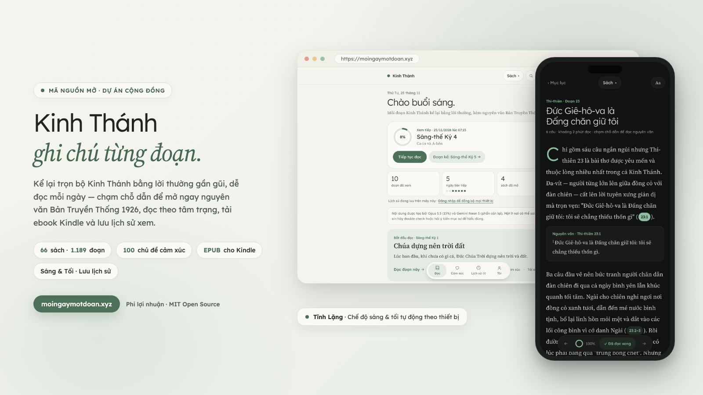
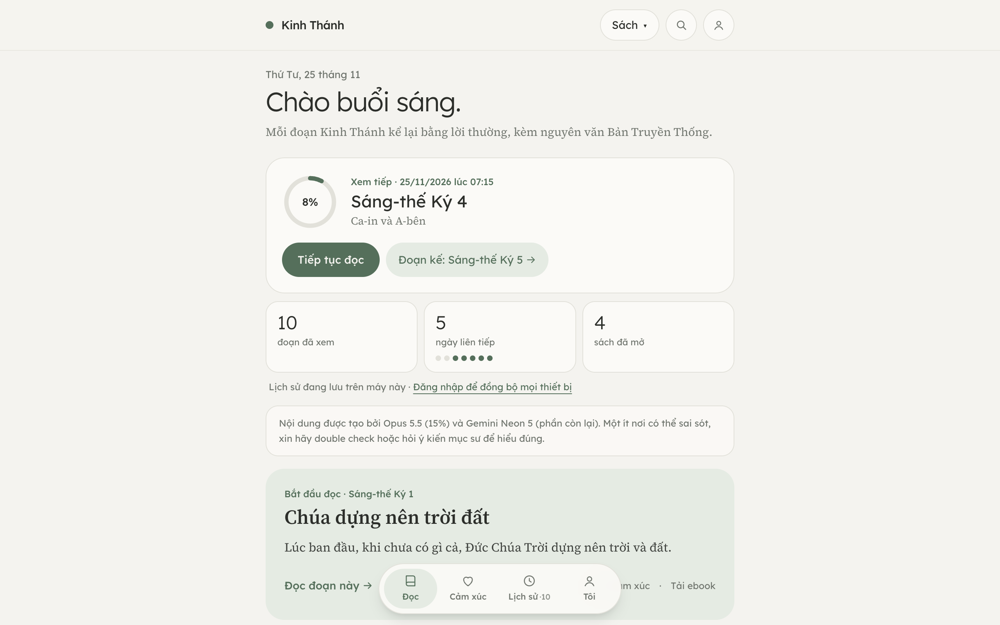
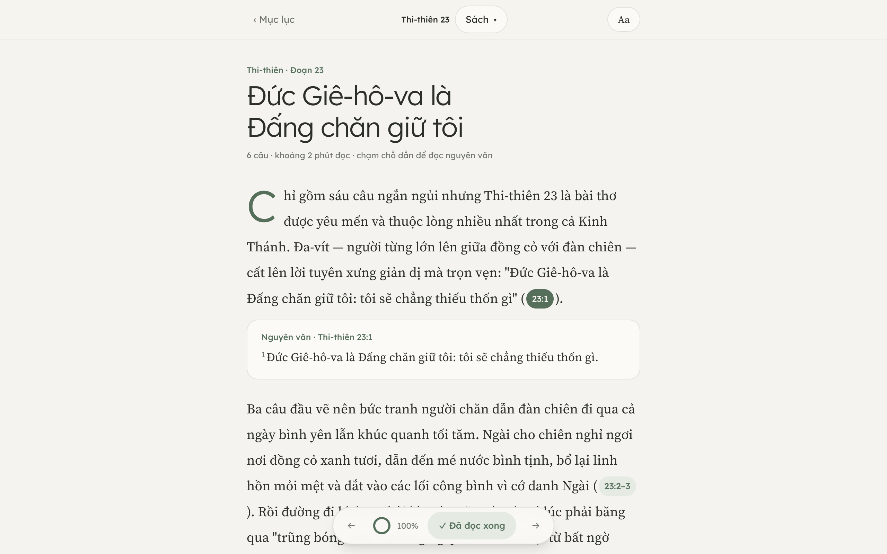
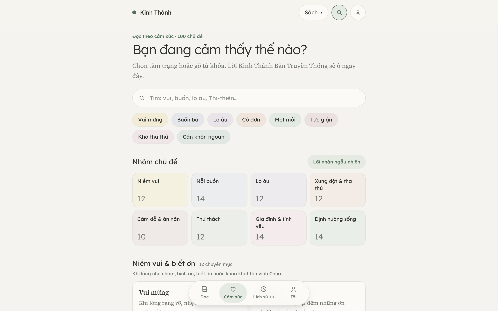
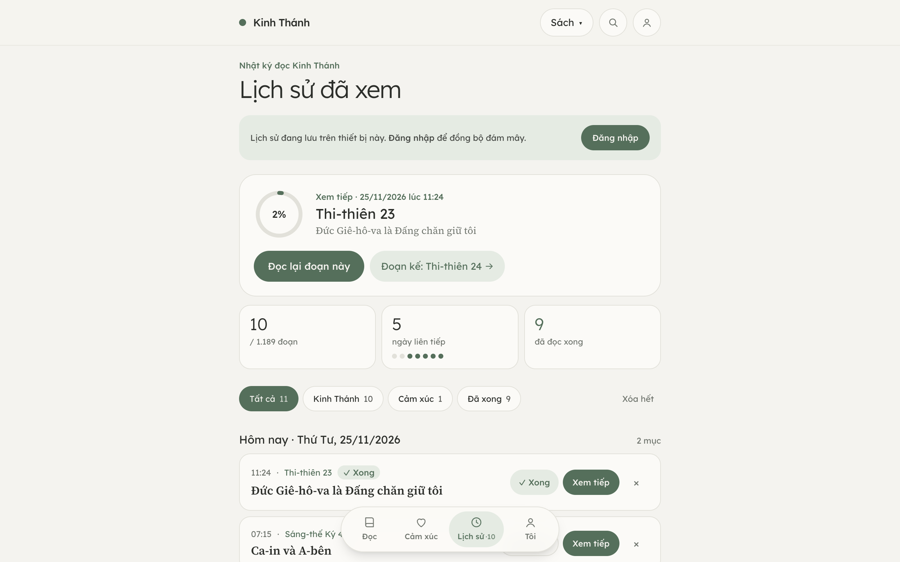
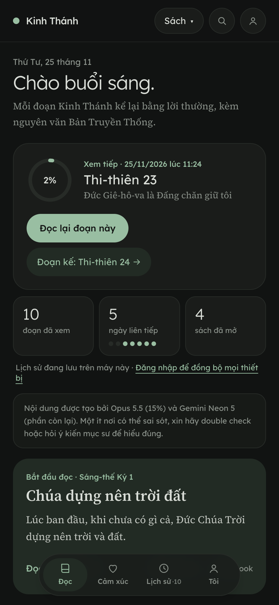
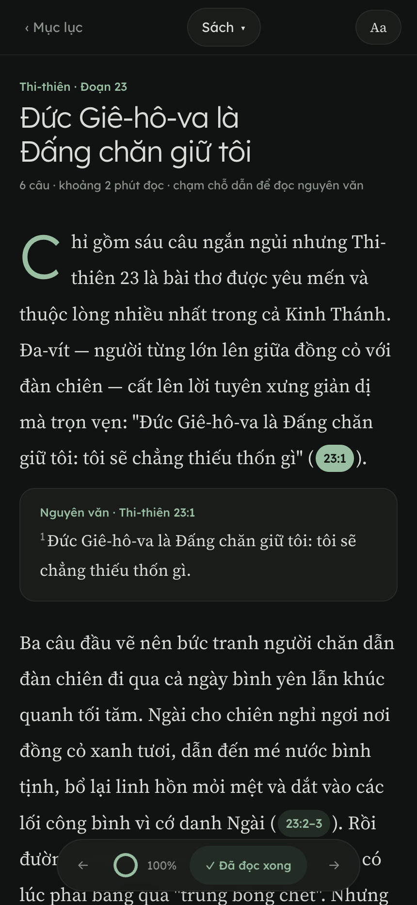

<div align="center">

# Mỗi Ngày Một Đoạn

### Plain-Language Vietnamese Bible Study — Chapter by Chapter

**English** · [Tiếng Việt](./README.vi.md)

<br />

**A calm, ad-free web app covering all 66 books and 1,189 chapters of the Bible in clear everyday Vietnamese — with tap-to-open 1926 Vietnamese Union Version scripture inline, 100 mood-based reading guides, offline Kindle EPUBs, and cloud-synced reading history.**

[](https://moingaymotdoan.xyz)
[](#community-commitment)
[](./LICENSE)
[](https://www.solidjs.com/)
[](#architecture--tech-stack)

<br />



<br />

[Open Live App](https://moingaymotdoan.xyz) · [Read Psalm 23](https://moingaymotdoan.xyz/thi-thien/23) · [100 Mood Guides](https://moingaymotdoan.xyz/cam-xuc) · [Kindle EPUBs](https://moingaymotdoan.xyz/ebook) · [Contributing](./CONTRIBUTING.md)

</div>

---

## Why This Exists

Many readers — especially new believers and busy young adults — want to build a daily habit of reading through the whole Bible, yet often stall when encountering long books, unfamiliar historical context, or formal archaic wording. On the other hand, reading standalone summaries elsewhere can easily drift away from Scripture itself.

**Mỗi Ngày Một Đoạn** (*One Chapter a Day*) creates a quiet, distraction-free reading space: you first grasp the flow of each chapter in warm, everyday Vietnamese, and with a single tap on any inline citation like `(23:1)`, the original **1926 Vietnamese Union Version (Bản Truyền Thống)** opens right beside the text — keeping you anchored to Scripture without ever losing your place.

## Community Commitment

> [!IMPORTANT]
> **Mỗi Ngày Một Đoạn** will **always remain non-profit, completely free, ad-free, privacy-respecting, and open source under the MIT License** to serve the Vietnamese Christian community for the long term.

> [!NOTE]
> **AI Attribution Transparency:** The chapter study notes were drafted with AI assistance (**Opus 5.5 ~15%** and **Gemini Neon 4** for the remainder). Some passages may still contain imperfections — please verify directly against Scripture or consult a pastor when in doubt. Theological, editorial, and technical contributions are warmly welcomed via [GitHub Issues](https://github.com/tinwritescode/moingaymotdoan/issues) and [CONTRIBUTING.md](./CONTRIBUTING.md).

---

## 30-Second Quick Tour

- **Read a familiar chapter:** Visit [Psalm 23 (`Thi-thiên 23`)](https://moingaymotdoan.xyz/thi-thien/23), tap `(23:1)` to expand the original verse inline, and click `Aa` to adjust reading font size.
- **Read by mood & life season:** Open [100 Mood Guides (`/cam-xuc`)](https://moingaymotdoan.xyz/cam-xuc), search for *"lo âu"* (anxiety) or *"biết ơn"* (gratitude), or try *Random Message*.
- **Read offline on Kindle or Apple Books:** Download ready-made [EPUB editions (`/ebook`)](https://moingaymotdoan.xyz/ebook) (concise notes or full-text editions).
- **Track your daily habit:** Check [Reading History (`/lich-su`)](https://moingaymotdoan.xyz/lich-su) for calendar-grouped history, reading streaks, book progress rings, and one-tap *Continue Reading*.

---

## Key Features

- **All 66 Books · 1,189 Chapters**: Consistent chapter structure with *Story* (plain-language retelling), *Key Takeaways* (*Điều cần nhớ*), *Deeper Meaning*, *Notes & Nuances*, and *What Commentators Say* (each labeled with a transparent confidence rating).
- **Inline Scripture Verification (1926 Public Domain)**: Tap any citation such as `(23:1)` or `(Giăng 3:16)` to view exact verses in place without navigating away. Automated tests verify every single citation across all 1,189 Markdown files against the canonical Bible dataset.
- **100 Mood & Life-Situation Guides**: Organized into 8 pastel-tinted groups (*Joy*, *Sorrow*, *Anxiety*, *Conflict & Forgiveness*, *Temptation & Repentance*, *Trials*, *Family & Love*, *Life Direction*), with instant accent-insensitive Vietnamese search and one-tap verse copying.
- **Reading History & Cloud Sync**: Automatically tracks reading dates, streaks, completed chapters, per-book progress rings, and *Continue Reading*. Works immediately without an account (`localStorage`), with optional **WorkOS AuthKit** sign-in to sync across devices via **Neon Postgres** (seamlessly merging guest history on sign-in).
- **Offline Kindle / EPUB Downloads**: Pre-generated EPUB 3 (+ EPUB 2 NCX) bundles for the *Full Bible*, *Old Testament*, and *New Testament* in both *Concise* and *With Full Chapter Text* editions, complete with tap-to-view footnote verses.
- **Quiet ("Tĩnh Lặng") Design System**: Soft *Sage & Stone* light and dark themes, Vietnamese-optimized typography (`Lexend` + `Source Serif 4`), customizable `Aa` reading scale, and a thumb-friendly floating bottom dock on mobile.

---

## Screenshots

| Home, Continue Reading & Streaks | Chapter Reader & Inline 1926 Scripture |
| :---: | :---: |
|  |  |

| 100 Mood & Life Guides | Date-Grouped Reading History |
| :---: | :---: |
|  |  |

### Mobile Dark Mode

<p align="center">
  
  &nbsp;&nbsp;&nbsp;
  
</p>

---

## Architecture & Tech Stack

| Layer | Technology |
| --- | --- |
| **UI & Routing** | [Solid 2.0](https://www.solidjs.com/) (`solid-js`, `@solidjs/web`, `@solidjs/router` 2) with file-based routing |
| **Styling & Typography** | [Tailwind CSS v4](https://tailwindcss.com/), Google Fonts (`Lexend` + `Source Serif 4`) |
| **Build & Static Delivery** | Vite 8 + custom static prerenderer (`scripts/prerender.mjs` generating **2,591 static files** + `404.html`), hosted on Vercel |
| **Authentication (Optional)** | [WorkOS AuthKit](https://workos.com/) (`@workos-inc/authkit-js`, PKCE SPA + RS256 JWKS verification) |
| **History API & DB (Optional)** | [Neon Functions](https://neon.tech/) (Hono + `jose`) backed by Lakebase Postgres through Prisma (`prisma/schema.prisma`) |
| **EPUB Generator** | Zero-dependency TypeScript EPUB 3/NCX builder (`lib/ebook/epub.ts`), built during prerender |
| **Testing & Quality** | Vitest (`@solidjs/testing-library` + `@solidjs/diagnostics`), TypeScript, Oxlint (`eslint-plugin-solid`) |

### Repository Structure

```text
├── content/                # 66 book folders, 1,189 chapter study note Markdown files
├── data/bible/             # 1926 Vietnamese Union Version Bible text (public domain)
├── lib/
│   ├── content/            # Markdown parser, scripture citation validator, 66-book TOC
│   ├── ebook/              # Pure TypeScript EPUB generator for Kindle / Apple Books
│   ├── history/            # Reading streak, stats, and progress types/helpers
│   └── moods/              # 100 mood topics (8 groups) + accent-insensitive Vietnamese search
├── src/
│   ├── routes/             # File routes: /, /[book]/[chapter], /cam-xuc, /lich-su, /tai-khoan, /ebook
│   ├── components/         # UI components (ChapterReader, FloatingDock, ProgressRing, MoodBrowser, Seo...)
│   └── lib/                # WorkOS client (auth.ts) & local/cloud history store (history-store.ts)
├── functions/history/      # Neon Function (Hono API) for authenticated cloud reading history
├── prisma/                 # Prisma schema, migrations and typed SQL for the history API
├── public/                 # Favicon, 1200×630 og-image.png, robots.txt
└── scripts/                # Static prerenderer, Bible importer, DB migration script
```

---

## Local Development

**Prerequisites:** Node.js `>= 22` and `pnpm`.

```bash
# 1. Clone the repository
git clone https://github.com/tinwritescode/moingaymotdoan.git
cd moingaymotdoan

# 2. Install dependencies
pnpm install

# 3. Start the dev server (no database or auth keys required!)
pnpm dev
```

Without any environment variables configured, every reading feature, mood search, EPUB download, and browser-local reading history (`localStorage`) works out of the box.

### Useful Scripts

```bash
pnpm dev        # Start local Vite dev server
pnpm build      # Build client/SSR and prerender all 2,591 static files into dist/client
pnpm preview    # Preview the production build locally
pnpm test       # Run all unit & component tests (including full Bible citation validation)
pnpm lint       # Run Oxlint with eslint-plugin-solid
pnpm typecheck  # Run TypeScript type checks
```

### Enabling Optional Cloud Sync (Self-Hosting)

```bash
cp .env.example .env.local
```

1. **WorkOS AuthKit**: Create an app in the [WorkOS Dashboard](https://dashboard.workos.com/), enable AuthKit (PKCE / Public Client), register your Redirect URI (`/tai-khoan`) and CORS origin, then set `VITE_WORKOS_CLIENT_ID` (and `WORKOS_CLIENT_ID`).
2. **Neon Postgres & Function**: Create a project on [Neon](https://neon.tech/), set `DATABASE_URL` in `.env.local`, run `pnpm db:migrate` to apply the [Prisma migrations](./prisma/migrations) (on an existing database made before Prisma, run `pnpm prisma migrate resolve --applied 0_init` first), add your domain to `ALLOWED_ORIGINS` in [`functions/history/index.ts`](./functions/history/index.ts), deploy via `neon deploy --env .env.local`, and set `VITE_HISTORY_API_URL`.

---

## Contributing

Contributions of all kinds are deeply appreciated — whether fixing a typo, reviewing theological accuracy, refining a chapter retelling, adding another language, or improving UI and accessibility.

- Report a content issue or suggestion: [Open a GitHub Issue](https://github.com/tinwritescode/moingaymotdoan/issues)
- Vietnamese editorial spec, citation rules, and PR checklist: see **[CONTRIBUTING.md](./CONTRIBUTING.md)**

### Adding another language

The site currently ships in **Vietnamese** (`/`) and **English** (`/en`). Contributions to bring **Mỗi Ngày Một Đoạn** to more languages are warmly welcome:

- **Not a developer?** Open a [GitHub Issue](https://github.com/tinwritescode/moingaymotdoan/issues) telling us which language you would like to translate or review — and, if you know one, a public-domain or open-licensed Bible translation for that language (for example on [eBible.org](https://ebible.org/)). We can help set up the technical scaffolding.
- **Want to open a Pull Request?** Follow the structure used by the English edition:
  1. Import a public-domain / open-licensed Bible text into `data/bible-<lang>/` (see `scripts/import-bible-en.mjs`).
  2. Add the locale, UI copy, routes, and legal text in `lib/i18n/` and 66 book names/slugs in `lib/content/books.ts`.
  3. Add chapter notes under `content-<lang>/` and mood guides under `lib/moods/<lang>/`.
  4. Wire routes under `src/routes/<lang>/` and list the locale's data endpoints in `scripts/prerender.mjs`, then run `pnpm lint && pnpm typecheck && pnpm test && pnpm build`.

---

## License & Public Domain Sources

- **Source Code**: Licensed under the **[MIT License](./LICENSE)** — feel free to use, adapt, or self-host for your church, small group, or ministry.
- **Vietnamese Scripture**: **1926 Vietnamese Union Version (Bản Truyền Thống)** (*public domain*), sourced from [eBible.org (`vie1934`)](https://ebible.org/find/details.php?id=vie1934).
- **Classic Commentaries**: Summarized in original wording with book attributions (no copyrighted excerpts copied). Full public-domain classics (Matthew Henry, John Calvin, Augustine, Charles Spurgeon) can be read free at [ccel.org](https://www.ccel.org/) and [spurgeongems.org](https://www.spurgeongems.org/).
