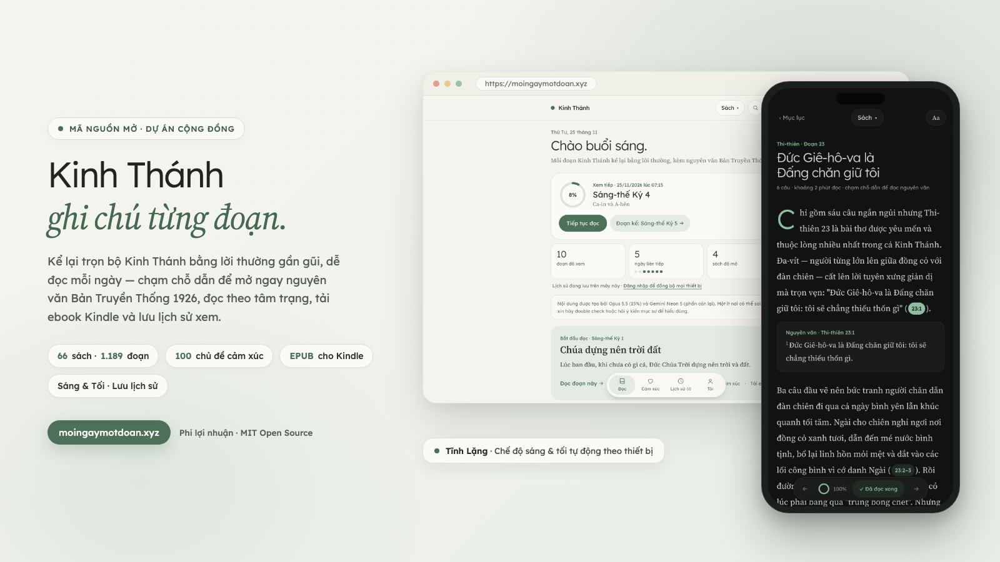
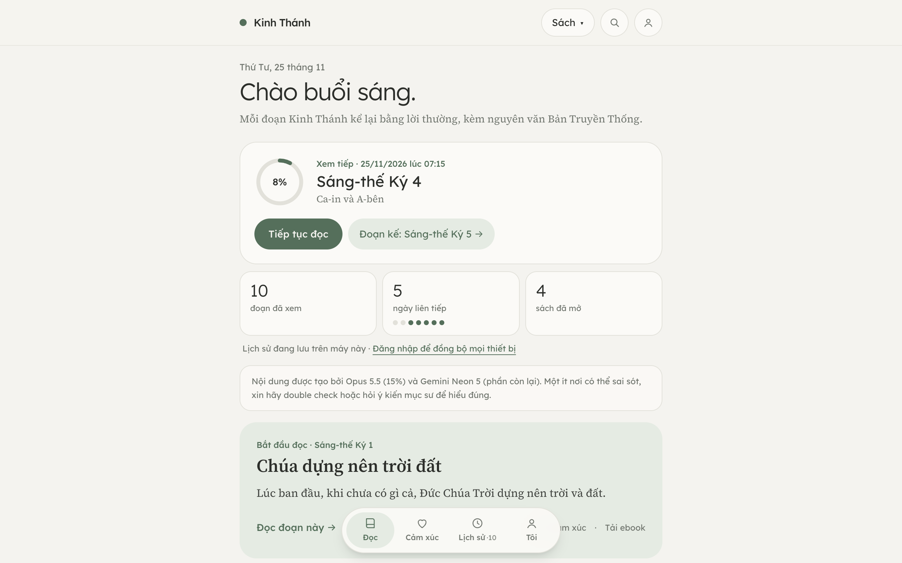
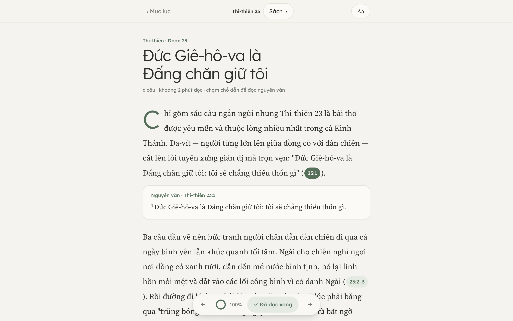
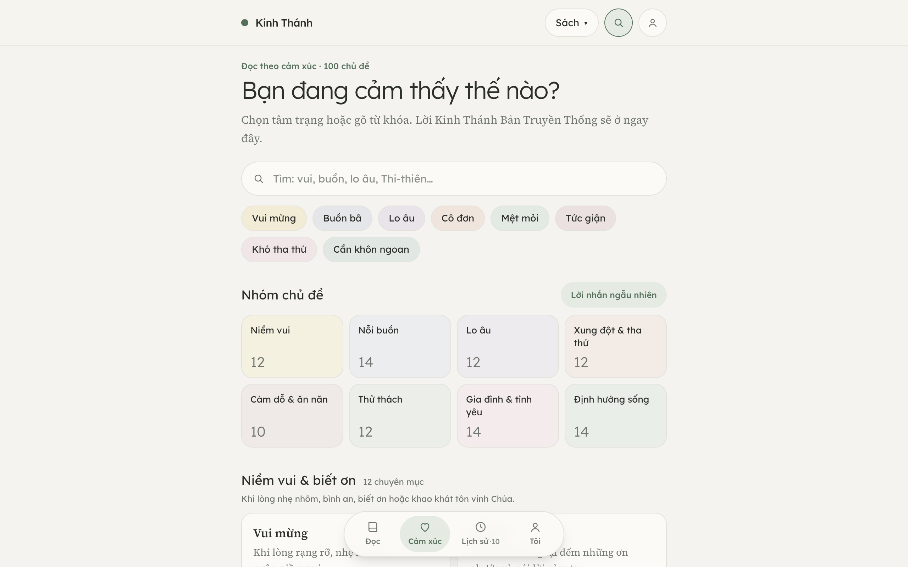
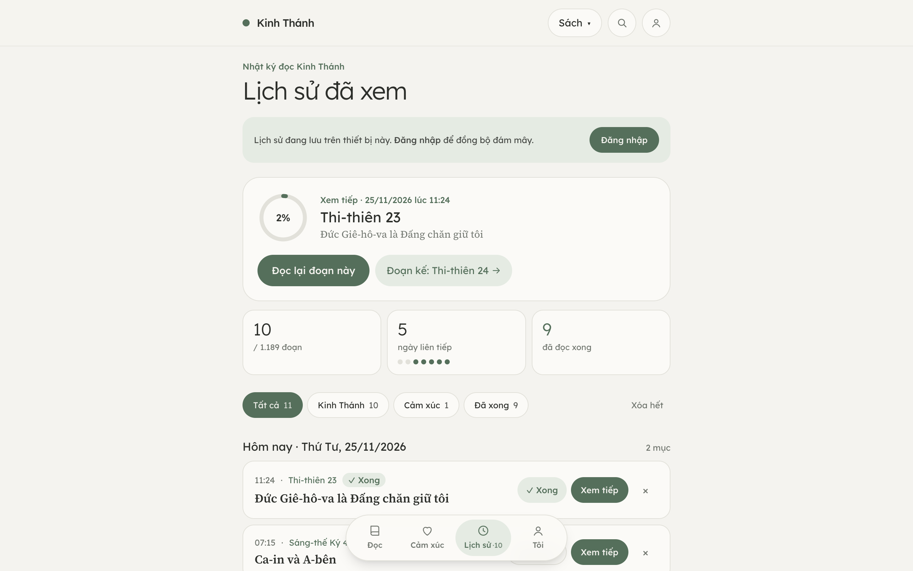
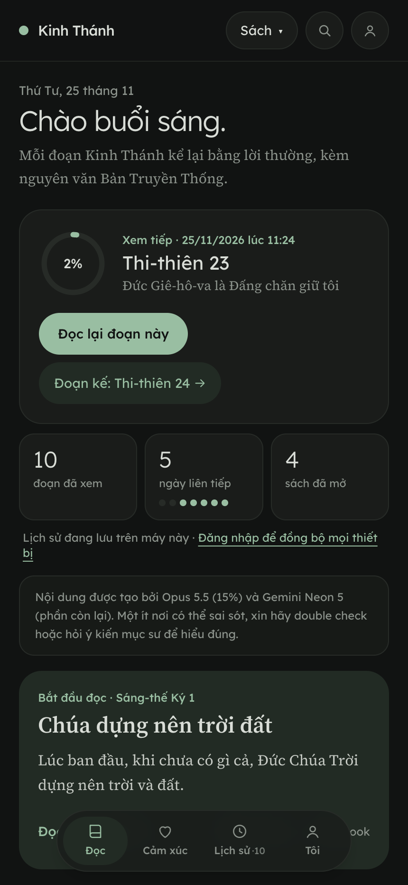
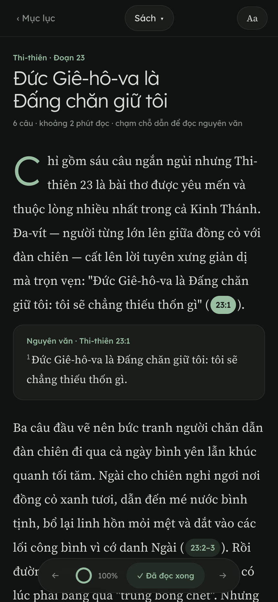

<div align="center">

# Mỗi Ngày Một Đoạn

### Kinh Thánh — ghi chú từng đoạn bằng lời thường

[English](./README.md) · **Tiếng Việt**

<br />

**Trọn bộ 66 sách · 1.189 đoạn Kinh Thánh kể lại dễ hiểu, chạm chỗ dẫn mở ngay nguyên văn Bản Truyền Thống 1926, 100 chủ đề theo cảm xúc, ebook Kindle và lịch sử đọc đồng bộ.**

[](https://moingaymotdoan.xyz)
[](#cam-kết-cộng-đồng)
[](./LICENSE)
[](https://www.solidjs.com/)
[](#kiến-trúc--công-nghệ)

<br />



<br />

[Trải nghiệm ngay](https://moingaymotdoan.xyz) · [Đọc thử Thi-thiên 23](https://moingaymotdoan.xyz/thi-thien/23) · [100 chủ đề cảm xúc](https://moingaymotdoan.xyz/cam-xuc) · [Tải Ebook Kindle](https://moingaymotdoan.xyz/ebook) · [Hướng dẫn đóng góp](./CONTRIBUTING.md)

</div>

---

## Vấn đề đặt ra

Nhiều anh chị em — nhất là người mới tin Chúa hoặc bận rộn hằng ngày — rất muốn đọc hết Kinh Thánh mỗi ngày, nhưng dễ chững lại khi gặp những sách dài, bối cảnh lịch sử xa lạ hoặc ngôn ngữ cổ trang trọng. Ngược lại, nếu chỉ đọc tóm tắt bên ngoài thì lại dễ rời xa nguyên văn Lời Chúa.

**Mỗi Ngày Một Đoạn** được tạo ra như một không gian đọc **dịu mắt và tĩnh lặng**: bạn đọc nhanh mạch câu chuyện của từng đoạn bằng lời thường trước, rồi chỉ cần **chạm nhẹ vào bất kỳ chỗ dẫn nào** như `(23:1)` để đối chiếu ngay với nguyên văn **Bản Truyền Thống 1926** tại chỗ mà không phải chuyển trang.

## Cam kết cộng đồng

> [!IMPORTANT]
> Nền tảng **Mỗi Ngày Một Đoạn** sẽ **luôn phi lợi nhuận, hoàn toàn miễn phí trọn đời, không quảng cáo, không bán dữ liệu người dùng và luôn duy trì mã nguồn mở (MIT License)** để phục vụ cộng đồng Cơ Đốc Việt Nam lâu dài.

> [!NOTE]
> **Minh bạch nguồn biên soạn:** Phần ghi chú diễn giải được biên soạn với sự hỗ trợ của AI (**Opus 5.5 ~15%** và **Gemini Neon 4** phần còn lại). Một ít nơi có thể còn sai sót — xin hãy đối chiếu trực tiếp với nguyên văn Kinh Thánh hoặc trao đổi thêm với mục sư để hiểu đúng. Mọi góp ý hiệu đính từ anh chị em và các mục sư đều rất quý giá tại [GitHub Issues](https://github.com/tinwritescode/moingaymotdoan/issues) và [CONTRIBUTING.md](./CONTRIBUTING.md).

---

## Trải nghiệm nhanh (30 giây)

- **Đọc thử một đoạn quen thuộc:** Mở [Thi-thiên 23](https://moingaymotdoan.xyz/thi-thien/23), bấm thử thẻ `(23:1)` để xem nguyên văn mở ngay trong mạch đọc và bấm nút `Aa` để đổi cỡ chữ.
- **Đọc theo tâm trạng hiện tại:** Mở [100 chủ đề cảm xúc](https://moingaymotdoan.xyz/cam-xuc), gõ thử *"lo âu"*, *"biết ơn"* hoặc bấm *Lời nhắn ngẫu nhiên*.
- **Đọc ngoại tuyến trên Kindle / điện thoại:** Tải sẵn [Ebook EPUB](https://moingaymotdoan.xyz/ebook) (bản gọn hoặc kèm nguyên văn cả đoạn).
- **Theo dõi thói quen đọc hằng ngày:** Xem [Lịch sử đã đọc](https://moingaymotdoan.xyz/lich-su) theo ngày tháng năm, chuỗi ngày đọc liên tiếp và nút *Xem tiếp*.

---

## Tính năng nổi bật

- **Trọn bộ 66 sách · 1.189 đoạn Kinh Thánh**: Mỗi đoạn có cấu trúc nhất quán gồm *Câu chuyện* (kể bằng lời thường), *Điều cần nhớ*, *Ý nghĩa sâu xa*, *Lưu ý* và *Các nhà giải kinh nói gì* (kèm nhãn mức độ tin cậy minh bạch).
- **Chạm chỗ dẫn mở nguyên văn tại chỗ**: Bấm vào bất kỳ dẫn chứng nào như `(23:1)` hay `(Giăng 3:16)` để xem nguyên văn **Bản Truyền Thống 1926** ngay trong bài đọc; mọi chỗ dẫn đều được bộ test kiểm chứng tự động so với dữ liệu Kinh Thánh gốc.
- **100 chủ đề đọc theo cảm xúc & hoàn cảnh**: Chia thành 8 nhóm tâm trạng (*Niềm vui*, *Nỗi buồn*, *Lo âu*, *Xung đột & tha thứ*, *Cám dỗ & ăn năn*, *Thử thách*, *Gia đình & tình yêu*, *Định hướng sống*), tìm kiếm tiếng Việt không dấu tức thì và sao chép nhanh câu Kinh Thánh.
- **Lưu lịch sử đọc & đồng bộ đa thiết bị**: Ghi nhận ngày tháng năm đã xem, số đoạn đã hoàn thành, chuỗi ngày liên tiếp, vòng tiến độ từng sách và thẻ **Xem tiếp**. Dùng ngay không cần tài khoản (lưu `localStorage`) hoặc đăng nhập qua **WorkOS AuthKit** để đồng bộ lên **Neon Postgres** (tự động gộp lịch sử khách).
- **Xuất sẵn Ebook EPUB cho Kindle / Apple Books**: 3 bộ (*Trọn bộ*, *Cựu Ước*, *Tân Ước*) × 2 phiên bản (*Bản gọn* và *Kèm nguyên văn cả đoạn*), có mục lục và chú thích bật câu Kinh Thánh ngay trên máy đọc sách.
- **Thiết kế Tĩnh Lặng (Quiet)**: Bảng màu *Sage & Stone* êm mắt, tự động hỗ trợ **Sáng & Tối**, typography tiếng Việt (`Lexend` + `Source Serif 4`), tùy chỉnh cỡ chữ `Aa` và thanh điều hướng nổi tối ưu cho thao tác một tay trên điện thoại.

---

## Giao diện thực tế

| Trang chủ, Xem tiếp & chuỗi ngày đọc | Trang đọc đoạn & mở nguyên văn tại chỗ |
| :---: | :---: |
|  |  |

| Đọc theo 100 chủ đề cảm xúc | Nhật ký lịch sử đọc theo ngày tháng năm |
| :---: | :---: |
|  |  |

### Giao diện Chế độ tối (Dark Mode) trên điện thoại

<p align="center">
  
  &nbsp;&nbsp;&nbsp;
  
</p>

---

## Kiến trúc & Công nghệ

| Thành phần | Công nghệ |
| --- | --- |
| **Giao diện & Routing** | [Solid 2.0](https://www.solidjs.com/) (`solid-js`, `@solidjs/web`, `@solidjs/router` 2), file-based routing |
| **Styling & Typography** | [Tailwind CSS v4](https://tailwindcss.com/), Google Fonts (`Lexend` + `Source Serif 4`) |
| **Build & Static Hosting** | Vite 8 + prerender toàn bộ **2.591 tệp tĩnh** + `404.html` (`scripts/prerender.mjs`), triển khai trên Vercel |
| **Xác thực (tùy chọn)** | [WorkOS AuthKit](https://workos.com/) (`@workos-inc/authkit-js`, PKCE SPA + xác thực JWT RS256 qua JWKS) |
| **API & Cơ sở dữ liệu (tùy chọn)** | [Neon Functions](https://neon.tech/) (Hono + `jose`) kết nối Lakebase Postgres (`db/schema.sql`) |
| **Ebook Generator** | Bộ tạo EPUB 3/NCX thuần TypeScript (`lib/ebook/epub.ts`), sinh sẵn trong bước prerender |
| **Kiểm thử & Chất lượng** | Vitest (`@solidjs/testing-library` + `@solidjs/diagnostics`), TypeScript, Oxlint (`eslint-plugin-solid`) |

### Cấu trúc thư mục

```text
├── content/                # 66 thư mục sách, 1.189 file Markdown ghi chú từng đoạn
├── data/bible/             # Nguyên văn Kinh Thánh Bản Truyền Thống 1926 (public domain)
├── lib/
│   ├── content/            # Parser Markdown, bộ kiểm tra chỗ dẫn Kinh Thánh, mục lục 66 sách
│   ├── ebook/              # Bộ tạo file EPUB cho Kindle / Apple Books
│   ├── history/            # Kiểu dữ liệu và hàm tính chuỗi ngày đọc, thống kê lịch sử
│   └── moods/              # 100 chủ đề cảm xúc (8 nhóm) và tìm kiếm tiếng Việt không dấu
├── src/
│   ├── routes/             # File routes: /, /[book]/[chapter], /cam-xuc, /lich-su, /tai-khoan, /ebook
│   ├── components/         # UI components (ChapterReader, FloatingDock, ProgressRing, MoodBrowser, Seo...)
│   └── lib/                # WorkOS client (auth.ts) & store lịch sử đọc (history-store.ts)
├── functions/history/      # Neon Function (Hono API) lưu và đồng bộ lịch sử đọc trên Postgres
├── db/schema.sql           # Schema bảng reading_progress và reading_logs
├── public/                 # Favicon, og-image.png (1200×630), robots.txt
└── scripts/                # Prerender tĩnh, import Kinh Thánh, migrate database
```

---

## Cài đặt & Chạy trên máy (Local)

**Yêu cầu:** Node.js `>= 22` và `pnpm`.

```bash
# 1. Clone repository
git clone https://github.com/tinwritescode/moingaymotdoan.git
cd moingaymotdoan

# 2. Cài đặt dependencies
pnpm install

# 3. Chạy môi trường phát triển (không cần database hay đăng nhập)
pnpm dev
```

Mở trình duyệt tại địa chỉ Vite hiển thị. Khi chưa cấu hình WorkOS/Neon, toàn bộ tính năng đọc, tìm cảm xúc, tải ebook và lưu lịch sử cục bộ (`localStorage`) vẫn hoạt động đầy đủ.

### Các lệnh thường dùng

```bash
pnpm dev        # Chạy dev server
pnpm build      # Build client/SSR và prerender toàn bộ 2.591 tệp tĩnh vào dist/client
pnpm preview    # Xem trước bản build
pnpm test       # Chạy toàn bộ unit & component tests (kèm kiểm tra chỗ dẫn Kinh Thánh)
pnpm lint       # Kiểm tra mã nguồn với Oxlint + eslint-plugin-solid
pnpm typecheck  # Kiểm tra kiểu TypeScript
```

### Bật đăng nhập & đồng bộ đám mây (tùy chọn khi tự triển khai)

```bash
cp .env.example .env.local
```

1. **WorkOS AuthKit**: Tạo ứng dụng trên [WorkOS Dashboard](https://dashboard.workos.com/), bật AuthKit (PKCE / Public Client), khai báo Redirect URI (`/tai-khoan`) và CORS Origin cho tên miền của bạn, rồi điền `VITE_WORKOS_CLIENT_ID` (và `WORKOS_CLIENT_ID`).
2. **Neon Postgres & Function**: Tạo dự án trên [Neon](https://neon.tech/), điền `DATABASE_URL` vào `.env.local`, chạy `pnpm db:migrate` để áp dụng [`db/schema.sql`](./db/schema.sql), cập nhật `ALLOWED_ORIGINS` trong [`functions/history/index.ts`](./functions/history/index.ts), triển khai bằng `neon deploy --env .env.local` và điền URL vào `VITE_HISTORY_API_URL`.

---

## Đóng góp & Hiệu đính

Dự án luôn trân trọng mọi đóng góp từ cộng đồng — dù là sửa một lỗi chính tả nhỏ, góp ý thần học cho một đoạn giải kinh, đóng góp thêm ngôn ngữ khác, hay gửi Pull Request cải tiến giao diện.

- Báo lỗi hoặc góp ý nội dung: [Mở GitHub Issue](https://github.com/tinwritescode/moingaymotdoan/issues)
- Quy chuẩn biên soạn Markdown, quy ước dẫn câu Kinh Thánh và hướng dẫn đóng góp ngôn ngữ mới: xem **[CONTRIBUTING.md](./CONTRIBUTING.md)**

### Đóng góp ngôn ngữ khác

Trang hiện hỗ trợ **Tiếng Việt** (`/`) và **English** (`/en`). Nếu bạn muốn giúp dịch hoặc hiệu đính cho một ngôn ngữ khác, bạn không cần biết lập trình — chỉ cần mở [GitHub Issue](https://github.com/tinwritescode/moingaymotdoan/issues) hoặc xem hướng dẫn chi tiết tại **[CONTRIBUTING.md](./CONTRIBUTING.md#5-đóng-góp-ngôn-ngữ-khác)**.

---

## Bản quyền & Nguồn tài liệu

- **Mã nguồn dự án**: Phát hành theo giấy phép **[MIT License](./LICENSE)** — bạn có thể tự do sử dụng, tùy biến và triển khai lại cho hội thánh, nhóm nhỏ hoặc dự án Cơ Đốc của riêng mình.
- **Lời Kinh Thánh tiếng Việt**: **Bản Truyền Thống 1926** (*public domain*), nguồn [eBible.org (vie1934)](https://ebible.org/find/details.php?id=vie1934).
- **Phần tóm tắt giải kinh**: Tổng hợp ý chính (không sao chép nguyên văn có bản quyền), luôn ghi tên sách để đối chiếu. Các tác phẩm giải kinh cổ điển công cộng (Matthew Henry, John Calvin, Augustine, Charles Spurgeon) có thể đọc toàn văn miễn phí tại [ccel.org](https://www.ccel.org/) và [spurgeongems.org](https://www.spurgeongems.org/).
